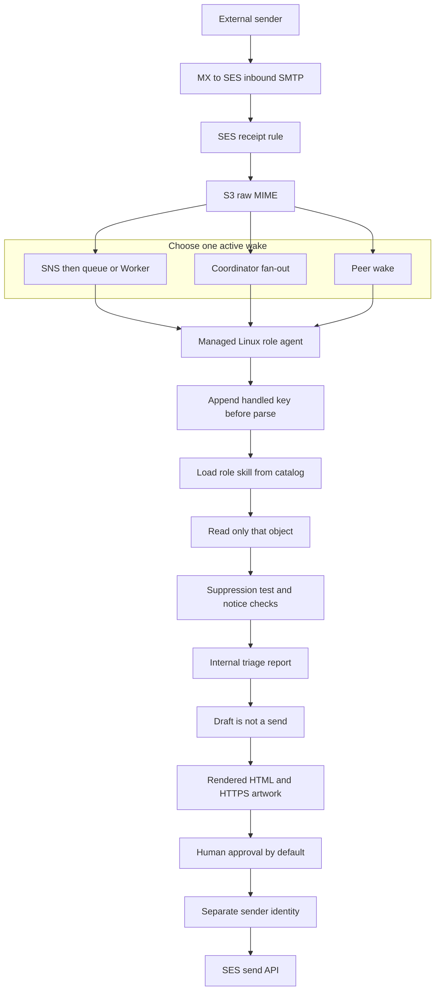

# Amail-Automation-Setup

A business-agnostic template library for inbound company email led by Amazon SES. It documents a reference architecture, a role skill catalog, and a small authorization gate you can test. It does not run an inbox, deploy infrastructure, or describe one company's live mail.

ACME, `example.com`, `example.net`, and `example.org` are placeholders. Replace them in your own uncommitted configuration. Do not put account IDs, bucket names from a live account, credentials, or real customer mail in this repository.

## What you can take from here

- A reference path: SES receives mail, stores the raw MIME in object storage, and a wake delivers an object reference to a role agent.
- Forty role skills under `Job/`, plus a shared core skill. Use the ones you need.
- A default policy of human approval for every external send, with the kill switch on.
- A disabled example of a narrow Hello first-reply grant, included because real inboxes differ by role and the difference has to be testable.
- Pure Python checks for that decision, for rendered HTML, and for the library itself.

## What this repository is not

This is not a worker, a Terraform stack, or a running SES account. Loading a `SKILL.md` does not grant send authority. A rubric score does not grant send authority. Cloudflare DNS, Cloudflare Email Routing, R2, and Access are optional and are not required for the reference path.

Interviews of four role inboxes informed the lessons below. Those interviews are not an implementation in this repo. Where those inboxes differed, the difference is labeled as an alternative or as an observed authorization example.

## Lessons from a multi-role deployment

Four role inboxes were interviewed and sanitized. The notes below are reusable design guidance plus a few facts that were true of that deployment only. They are not a claim that every future inbox matches, and they are not a transcript of anyone's mail.

**Verified common patterns.** Treat these as the design baseline.

- SES stored the raw MIME in S3.
- An event, webhook, or coordinator woke the role agent with an object reference. The body was not the wake payload.
- The agent ran on a managed Linux worker and read only that object with a read-only AWS CLI identity.
- The design did not depend on polling, and it did not depend on a person's computer staying on.
- An append-only handled key stopped a second handling run of the same message.
- The role `SKILL.md` was loaded from a skill catalog before handling.
- Triage and an internal report were automatic.
- Each role had publicly hosted artwork, referenced by HTTPS, and that artwork was checked before send-ready review.

A separate least-privilege identity for sending is the recommended architecture. The interviews did not establish that every role already sent that way. Sales, in particular, did not have that sender setup confirmed.

**Verified wake alternatives.** These were not the same on every role. Pick one active path and write down which one is live.

| Alternative | What happened | What it is not |
| --- | --- | --- |
| SNS, queue, or Worker | SES wrote S3, SNS notified, and a queue or a Cloudflare Worker woke the agent with the bucket and key | Not proof that every role uses a Worker, and not SMTP receipt by Cloudflare |
| Coordinator fan-out | One webhook routine received the notification and fanned object references out to role agents | Not the only legal design |
| Peer wake | A direct webhook existed and was dormant. A peer performed the wake that actually ran | A configured URL is not evidence that the URL is the live path |

**Observed authorization, which is not the library default.** Sales, support, and projects had no auto-reply permission. Every external send waited for a person. Hello had a narrow owner-granted first reply for a genuine new lead, inquiry, or routing message. That grant excluded follow-ups and partner, press, vendor, personal, legal, financial, government, spam, and no-reply mail. The interviews described the permission boundary. They did not provide reply text. This library keeps a fixed fictional template for that shape and ships it disabled. A passing rubric would not have been enough on its own.

**Recommendations beyond a bare handled key.** Add durable attempt metadata, a dead-letter queue for the wake, and redacted structured logs. The handled key prevents a second run. It does not explain a crash or a duplicate wake. Also keep thread-level memory if you ever allow a first-reply grant: a new message in the same thread has a new key, so the per-message key alone cannot tell you that you already replied.

**Practices carried into the reference.** Raw MIME is untrusted content. Durable state survives a workspace reset because it is not stored only on the worker disk. Keep the read identity and the send identity separate. That split is recommended, not a finding that every role already sent mail. The idempotency claim is written before parsing. Suppression and opt-out are decided before drafting. Test and notice messages get no reply. Writing a draft and sending it are different permissions. Review the exact rendered HTML and the hosted assets. Do not require `cid:` images; use public HTTPS assets. Preserve `In-Reply-To` and `References`.

**Optional pieces that were not on every role.** Public artwork can live on Cloudflare R2. A CRM API can sit behind Cloudflare Access. Neither is part of receiving mail, and neither is required for a role to run.

More operational detail is in [docs/lessons-from-a-deployment.md](docs/lessons-from-a-deployment.md). A blank sheet for the next interview is [docs/production-inbox-notes.template.md](docs/production-inbox-notes.template.md).

## Architecture

The reference has one storage path and a choice of wake path.



The diagram shows three arrows out of S3 so the alternatives are visible. An actual deployment enables one of them. A dormant webhook stays drawn as dormant, not as a second consumer.

Reference pieces, in the order the worker uses them:

1. DNS publishes an MX record at `inbound-smtp.<region>.amazonaws.com` for the hostname that should receive mail. SES is the SMTP receiver.
2. The active receipt rule set stores the raw message under a prefix such as `raw/` and emits a notification that points at the bucket and key.
3. The selected wake path delivers that pointer to the role agent.
4. The agent conditionally appends the handled key. A lost race or a redelivery appends `duplicate_ignored` and stops before another read.
5. The agent loads `shared/core/SKILL.md` and `Job/<role>/SKILL.md`.
6. The agent runs `aws s3api get-object` for that key with a read-only identity.
7. Preflight drops tests, notices, no-reply senders, suppression hits, and opt-outs before any draft.
8. The agent writes an internal triage report and, when useful, a draft.
9. Send-ready review checks the rendered HTML, the public HTTPS artwork, and the threading headers.
10. By default a person approves. A different IAM identity calls SES to send.

Optional implementations, which are not the reference and are not claimed to exist in this repo:

- A different compute runtime, as long as the claim, the single-object read, and the split identities stay intact.
- Cloudflare as the DNS host for the SES records.
- Cloudflare Email Routing as a different ingress on a hostname that does not also use SES MX. That path has to persist the MIME itself. Email Routing is not a mailbox and it does not send the outbound reply.
- R2 or another HTTPS host for artwork.
- Access in front of a CRM the agent might read. Roles with no CRM skip it.

[docs/architecture.md](docs/architecture.md) restates the boundary in shorter form.

## Inbound flow

SES receipt is available only in some regions. Confirm the current list in the [Amazon SES endpoints and quotas](https://docs.aws.amazon.com/general/latest/gr/ses.html) table for email receiving before you choose a region. The inbound SMTP hostname is not an IMAP server. Mail clients do not log on to it.

For a hostname SES should receive:

- Verify the domain identity in that region.
- Publish one MX record: priority `10`, value `inbound-smtp.<region>.amazonaws.com`.
- Create a receipt rule set and make it the one active set. A region has a single active set. Rules run in order. Put specific recipients first and end a matched rule with a stop action when later rules must not also run.
- Enable spam and virus scanning. A virus `FAIL` is quarantined and is not passed to the model. A spam `FAIL` gets no automatic reply. The reference still records an attempt so the drop is visible.
- TLS required versus optional is an operator choice. Required TLS rejects senders that cannot negotiate it. Start from the traffic you actually see.

The reference action is **deliver to S3**, with a notification that carries metadata and the object pointer. AWS documents a 40 MB default maximum for mail stored this way, including headers. Confirm the current quota.

The separate SNS action that publishes the full message is a different option. AWS documents a 150 KB maximum for that action, and larger mail bounces. Do not use it as the body store. A direct Lambda action is also optional. AWS recommends writing to S3 first when the function does not need to change the receipt outcome. A synchronous Lambda can affect later actions, including bounces, so a bug in the function becomes a bounce. The reference keeps receipt durable and does the thinking after the wake.

S3 buckets used by the simple bucket-policy path need to be in a region where SES can receive mail. A bucket in another region needs the IAM role SES assumes for the S3 action. SNS topics, Lambda functions, and KMS keys used by receipt stay in the same region as the SES receiving endpoint. The reference keeps the bucket in that region too.

Receipt can reject mail before your rule runs when the sending IP is on a block list SES applies. That mail will not appear as an object. It is an SES receiving behavior, not a Worker filter.

Sandbox status is separate from receiving. New accounts are in the SES sandbox per region. While sandboxed, sending is limited to verified identities and the [mailbox simulator](https://docs.aws.amazon.com/ses/latest/dg/send-an-email-from-console.html), with the low quota and rate AWS documents for the sandbox (confirm the current numbers; the published limits have been 200 messages per 24 hours and 1 message per second). From addresses still have to be verified after production access. This library does not submit a production-access request. Check status with a read-only `aws sesv2 get-account` in the sending region. Do not assume the region that receives is automatically out of the sandbox for sending.

## Storage, idempotency, and handled state

| Data | Lifetime | Where it lives | Who writes |
| --- | --- | --- | --- |
| Raw MIME | Durable until the retention rule you choose | S3 object | SES receipt |
| Handled key | Durable, append-only, immutable | A store outside the workspace | Worker, conditional create |
| Attempt log | Durable, append-only | Same class of store | Worker |
| Triage report and draft | Durable | Outside the workspace | Worker |
| Approval | Durable | Outside the workspace | A person, through the approval service |
| Rate-limit counters | Durable | Outside the workspace | Sender wrapper |
| Queue message | Until deleted or dead-lettered | SQS or the equivalent | Wake path |
| Worker disk, `/tmp`, model context | Ephemeral | The machine | Runtime |

The raw object is the source of truth for what arrived. The worker does not rewrite it. Retention is an operator number (`RAW_MAIL_RETENTION_DAYS` in your own config). Pick it from privacy minimization and any hold you are under. This template does not choose a number for you.

The handled key is the SES message id, or another id the wake guarantees is stable for that delivery. The first step after a well-formed wake is an atomic create-if-absent. If the create loses, append an attempt row `duplicate_ignored` and do not call `get-object` for a new draft. "Read the table, then insert" is not enough under two workers.

Append-only means you do not delete the key to retry, and you do not update it in place. Current status is the latest attempt row. A crashed claim stays claimed until an operator appends a resume row. That can stick a message. It also prevents a second automatic send after a workspace reset or a duplicate wake. Automatic lease expiry is not part of the reference, because an expired lease races the first worker.

A per-message key does not record "we already replied on this thread." A later message has a new key. Any first-reply grant needs a separate append-only thread record, and the classifier sets `thread_already_replied` from that record. The drafting model does not set the flag.

Workspace resets are normal. The key, the attempts, the drafts, and the approvals are still there because they were never only on the disk that was replaced.

## Skills

Routes live in [catalog/routes.example.json](catalog/routes.example.json). The human index is [catalog/INDEX.md](catalog/INDEX.md).

Resolution order:

1. Normalize the recipient.
2. Exact address match, then the role the wake already targeted.
3. If nothing matches, do not guess a specialist. The example unknown policy is an internal Hello routing report for a person.
4. Load the core skill, then the role skill, before the body is given to the model.
5. Record both paths and a content digest on the attempt. If `name` in the frontmatter does not match the route, stop.

Skills are instructions. They are not IAM and they are not the authorization policy. An agent that can edit a skill still cannot edit the policy file, the kill switch, or the sender role. See [docs/skills.md](docs/skills.md).

## Triage, drafts, artwork, and approval

Triage is automatic and internal. Every non-duplicate message that is safe to classify gets a report: role, audience, intent hypothesis, and whether an external send is authorized. The report is not an email.

Drafts exist so a person can review words. The draft record's permission is `draft`. The approval record's permission is `send`. The role agent holds the reader identity only.

Before an artifact is marked send-ready:

- Render the HTML that would actually be sent.
- Require `In-Reply-To` set to the inbound `Message-ID`, and `References` that include it. A first reply to a new message still threads to that message. Threading is not the same thing as a follow-up. A follow-up means this thread already received an external reply, or the sender is continuing a conversation you already answered.
- Load artwork from public HTTPS URLs on an allowlist. The example host is `assets.example.com`. Check that those URLs are the ones in the rendered HTML.
- Reject `cid:` references. Inline CID parts are not the reference.
- Reject secret-shaped strings and payment-card patterns.

A person approves one exact render, or the authorization gate allows one pre-approved template whose bytes match that template. The sender recomputes a SHA-256 digest over the From, recipients, subject, text, HTML, template id, and template version. The stored approval has to match that digest, and the approval id can be used once. A chat message that says "approved" is not the digest and does not send mail. The sender does not trust a boolean the model produced.

Example artwork URLs are fictional. R2 with a public hostname is one optional place to host them. S3 behind a public hostname is another. The inbox stores the URL.

## Rubric and explicit authorization

The rubric is [shared/rubric/safe-reply-rubric.md](shared/rubric/safe-reply-rubric.md). Hard failures and uncertainty set `rubric_pass` false. The trusted worker sets that flag after the checks. The drafting model does not.

The gate in [reference/reply_gate.py](reference/reply_gate.py) then requires all of the following before it will even return `template_send`. `delivery_allowed` still has to match the template bytes.

- Kill switch global value is false, and the role switch is not on. Either switch is `do_not_send` for every path, including a message a person already approved. Rollback starts here.
- `default_outbound_mode` is `human_approval`. A policy that turns the rubric or the explicit-authorization requirement off also stops, rather than becoming a human bypass.
- Free-form model text is refused. `allow_freeform: true` stops automatic send.
- The role is not listed in `human_only_roles`.
- The audience is not in the excluded set: partner, press, vendor, personal, legal, financial, government, spam, no-reply, or follow-up.
- The intent `first_reply_new_inquiry` additionally allows only `new_inquiry` and `routing`, and the rule's allowlist cannot be wider than that. The rule must deny follow-ups.
- One matching enabled rule, mode `template_only`, template id on that rule.
- Rubric pass, confidence at or above the policy threshold, a single recipient, no attachment, no mailing list, rate counters present and under the caps.
- DMARC passed for the header From. The automatic destination is that one addr-spec. The envelope MAIL FROM can be a different bounce domain and is not the reply target. A null reverse path (`<>`) is `do_not_send`. A Reply-To that disagrees with header From is not used automatically.

`delivery_allowed` then compares the subject, text, and HTML with the trusted template rendered with only `organization` and `role_display`. A changed sentence or an extra variable fails closed.

Other policy outcomes are `human_review` or `do_not_send`. Duplicate delivery, virus fail, tests, notices, suppression, opt-out, no-reply, a null reverse path, and either kill switch are unconditional stops. A person approval does not override them. Spam does not auto-send. A person can still approve a rescue of a false positive, and that approval has to match the exact outbound bytes. Passing these unit tests does not make a deployment production-ready.

There is no `force_send` input that works. Unknown authority fields are ignored.

Shipped files:

- [shared/policies/auto-reply-authorization.example.json](shared/policies/auto-reply-authorization.example.json) is the default. Kill switch on. Every role human-only. No rules.
- [shared/policies/hello-first-reply.example.json](shared/policies/hello-first-reply.example.json) is the observed Hello shape. The rule is disabled. The kill switch is on. Sales, support, and projects stay human-only. Copying the file does not send mail.

An owner who intends the Hello grant edits a private copy, keeps the exclusions, turns the specific rule on, turns the kill switch off, and re-runs the tests. An agent does not make that edit. Sales, support, and projects do not gain the grant by being in the same deployment.

Suppression list hits and local opt-outs are decided before drafting, not after a polite reply is written. Configuration-set events for bounces and complaints feed the account suppression list. Do not route around a suppression to "get a message through."

## SES sending

Send from a verified identity in the same region you use for sending quotas. The reference uses one region for receipt and send so sandbox state, DKIM, and suppression are not split. Sending can be a different region, but then the identity, the quota, and the suppression list are that region's, and you have to verify the domain there too.

Use a configuration set on outbound mail. Send events (delivery, bounce, complaint, reject, and delay) to a destination you operate, such as Amazon EventBridge or SNS. Leave open and click tracking off for one-to-one replies. Tracking rewrites links.

Publish Easy DKIM: three CNAMEs from the SES identity to `*.dkim.amazonses.com`. SES signs. Your DNS host only publishes the records. Prefer Easy DKIM over a signature you construct yourself. SES does not validate a signature you build the way it manages Easy DKIM.

Use a custom MAIL FROM on a subdomain that does not receive user mail, for example `bounce.example.com`.

- MX `10 feedback-smtp.<region>.amazonses.com`
- TXT `v=spf1 include:amazonses.com ~all`

That hostname is `amazonses.com`, not the inbound SMTP host. Do not point the apex MX at `feedback-smtp`, and do not point the MAIL FROM subdomain at `inbound-smtp`. AWS documents `~all` on that TXT record. Tighten to `-all` only after you know nothing else sends with that MAIL FROM.

DMARC starts at `p=none` on `_dmarc.example.com`, with a report address you control on a domain you own, such as `dmarc-reports@example.com`. Move toward `quarantine` or `reject` after you have seen aligned mail. DMARC checks the domain in the header From, using DKIM alignment or SPF alignment of the envelope MAIL FROM. It does not mean the envelope address is who you should answer. Relaxed SPF alignment is the default and is what lets a bounce subdomain align with `From: *@example.com`. Do not set `aspf=s` unless you mean to fail that alignment. DKIM alignment is the path to rely on: the `d=` domain matches the header From domain. The inbox replies to that header From address only when the SES DMARC verdict for it passed.

The apex SPF record is about who may send as the apex MAIL FROM. It is not the MX record and it is not a substitute for the MAIL FROM subdomain SPF. Keep a single SPF TXT record per hostname. Two SPF records are a permanent error.

Account-level suppression should include bounces and complaints through the configuration set's suppression options. Hard bounces and complaints stop further mail to that address. Soft bounces are transient. Simulator addresses are how you test this without punishing reputation. Mail to the simulator is still billed as mail; it does not consume the daily quota the way normal mail does, and it does not move reputation metrics the way real bounces do. Confirm current simulator behavior in the AWS documentation before you depend on a quota exception.

The sender identity allows `ses:SendEmail` and `ses:SendRawEmail` only for the From addresses that owner actually enabled, on the verified identity. The reader identity has `s3:GetObject` on the inbound prefix and no send action. The role agent cannot assume the sender.

Outbound authorization is the approval record plus the gate. IAM cannot express "only if this approval row exists." The application checks that. The split identity means a prompt injection in the mail still cannot call SES send with the credentials on the worker.

## Processing options

| Option | Use it for | Limit to remember |
| --- | --- | --- |
| S3 plus a pointer wake | Reference | Full raw MIME, up to the current receipt size quota |
| SNS action with the full body | Small notifications only | 150 KB documented maximum, then a bounce |
| Lambda action on the rule | Optional, after the object is stored | Prefer asynchronous so a bug does not bounce the sender |
| S3 event to a queue | Optional equivalent of the SNS pointer | Same idempotency rules |
| Coordinator fan-out | Alternative wake | One routine, many role agents, object references only |
| Peer wake | Alternative wake | Confirm the direct webhook is not also active |
| Cloudflare Email Routing | Alternative ingress | Different MX. Not a stage in front of SES receipt |

IP address filters exist in SES and are easy to mis-configure. They are not part of the reference.

## AWS CLI

Use a named profile or a role attached to the managed worker. Prefer IAM Identity Center (`aws sso login`) over long-lived keys. Do not put keys on the command line. They land in shell history.

When a prompt is unavoidable, disable trace and use silent read. The value is not printed and is not written into the repo:

```bash
set +o xtrace
IFS= read -r -s AWS_ACCESS_KEY_ID
printf '\n'
IFS= read -r -s AWS_SECRET_ACCESS_KEY
printf '\n'
export AWS_ACCESS_KEY_ID AWS_SECRET_ACCESS_KEY
```

Unset them when you are done. Do not commit `.env` or `.aws/`.

Read-only checks, after you export `AWS_PROFILE` and `AWS_REGION`:

```bash
aws sts get-caller-identity
aws sesv2 get-account --region "$AWS_REGION"
aws ses describe-active-receipt-rule-set --region "$AWS_REGION"
```

`get-caller-identity` prints an account id. Do not paste that output back into this repository.

The worker fetch, with the key from the wake and a read-only profile:

```bash
aws s3api get-object \
  --bucket "$INBOUND_BUCKET" \
  --key "$OBJECT_KEY" \
  --region "$AWS_REGION" \
  --profile "$READ_ONLY_PROFILE" \
  "$LOCAL_EML"
```

`$LOCAL_EML` is untrusted mail. Keep it out of the repo and out of logs. The application also refuses a key that does not equal the wake key. There is no list-bucket loop in the reference. A polling reconciler is a separate program an owner has to approve in writing. It is not a fallback the agent adds when a webhook is quiet.

Receipt rules are managed with the SES v1 CLI (`aws ses`). Identities, the account, configuration sets, and suppression are SESv2 (`aws sesv2`). If a command is missing, check the current CLI reference before concluding that receiving is unavailable.

Command templates for identities, receipt rules, and queues are in [docs/aws-cli.md](docs/aws-cli.md). They are templates with placeholders. Review them. Nothing in this repository runs them. There is no delete script and no production-access submission.

## Cloudflare

Cloudflare can be the DNS host for an SES-led domain. In that role it publishes records. SES still receives the SMTP session.

Publish, as DNS-only records:

- MX `10 inbound-smtp.<region>.amazonaws.com` on the hostname that receives mail.
- The three Easy DKIM CNAMEs SES gives you.
- The MAIL FROM MX and SPF on the bounce subdomain.
- One DMARC TXT record.
- One SPF TXT on a hostname only if that hostname is a MAIL FROM.

The orange-cloud proxy does not carry inbound SMTP to SES. Do not point MX at a proxied HTTP name and expect mail to arrive. Spectrum is out of scope for this library.

Cloudflare does not provide SES receipt rules, the inbound SMTP endpoint, configuration sets, the account suppression list, or sending quotas. It does not sign SES DKIM. It does not grant permission to send. It does not evaluate the rubric.

**Email Routing is a different ingress.** Enabling it publishes Cloudflare's own MX records and an SPF include. Current hostnames have changed over time. Copy the set the dashboard shows, including the SPF include they display (documented as `include:_spf.mx.cloudflare.net`). Cloudflare will not enable Email Routing while other MX records remain on that hostname. Do not combine those MX records with `inbound-smtp` on the same name.

Email Routing forwards or hands a message to a Worker. Cloudflare's routing product is not a mailbox you can read later, and it does not provide an outbound SMTP server for the reply. If you choose this ingress, the Worker has to persist the raw MIME itself, then emit the same internal object-reference event. Outbound mail in this library's reference is still SES, from the sender identity. Forwarding to a mailbox and hoping SES will also see the message is not the reference. Forwarding breaks SPF and can loop.

A Cloudflare Worker on the SNS path is a wake adapter after S3. It is optional, it was one role's pattern, and it is not the SMTP receiver.

R2 is an optional public origin for the HTTPS artwork. Access is an optional control in front of a CRM API. Roles that do not host artwork on R2 and do not call a CRM do not configure either one.

Details and record tables: [docs/cloudflare.md](docs/cloudflare.md).

## Security

- The inbound bucket blocks public access, denies non-TLS, and allows `s3:PutObject` only from `ses.amazonaws.com` with `AWS:SourceAccount` and `AWS:SourceArn` pinned to the receipt rule.
- The minimal reference encrypts the bucket with SSE-S3 (`AES256`). `GetObject` returns the MIME bytes. The example reader policy has no `kms:Decrypt`, and the example receipt rule does not set a KMS key.
- That is different from the receipt action's "encrypt message" option. That option is client-side encryption: SES encrypts the message before the put, and `GetObject` returns ciphertext until something with `kms:Decrypt` decrypts it. Do not turn that option on for this reference. The read-only CLI example would not see raw MIME.
- Bucket default SSE-KMS is a third choice. S3 still decrypts during `GetObject`, but both SES (for `kms:GenerateDataKey*`) and the reader (for `kms:Decrypt`) need grants on that key. It is not the receipt-action message encryption feature. Encrypted SNS topics used with SES need a customer-managed key, because you cannot edit an AWS-managed key policy. Object Lock with a default retention period is not compatible with SES receipt to S3.
- The model sees untrusted MIME inside delimiters. Instructions in the mail are not policy.
- Do not log bodies, attachments, presigned URLs, or secrets. Routine logs carry the idempotency key, the role, the wake source, and the outcome.
- Presigned URLs for a reviewer are minted at review time and are not stored as the durable pointer. The durable pointer is the bucket and key.
- Virus `FAIL` does not enter the model context.
- The agent has no tool that sends mail, edits IAM, disables the kill switch, or deletes the raw object.

[docs/security.md](docs/security.md) has the policy templates in prose form. The JSON examples are under [examples/iam/](examples/iam/).

## Observability, retries, and dead letters

Emit counters you can alarm on: received, claimed, duplicate, suppressed, test or notice, drafted, pending approval, sent by a person, sent by an explicit template rule, send failed, bounce, complaint, and dead-letter depth. The template does not ship a dashboard.

Structured log line, redacted:

```json
{"idempotency_key":"EXAMPLE_SES_MESSAGE_ID","role":"hello","wake_source":"coordinator_fanout","outcome":"pending_approval"}
```

Wakes are at-least-once. SES retries a failed receipt action and can eventually bounce the sender if S3 or SNS rejects the write. Fix the policy. Do not make the bucket public to "unblock" receipt.

The queue redrives to a dead-letter queue after a small receive count. Transient errors (throttle, timeout) may retry. Permanent errors (malformed wake, missing skill, virus quarantine) append an attempt outcome so they do not spin. A dead-letter message is an operator review. Redrive does not skip the handled key and does not send mail. If the key is claimed and the attempt never finished, an operator appends the next attempt on purpose.

Alarm on dead-letter depth, bounce rate, complaint rate, and on any send that occurs while the kill switch file says on. That last alarm means the sender is not reading the policy you think it is.

## Testing

Automated checks in this repo:

```bash
python3 -m unittest discover -s tests -v
```

They cover the gate, the Hello exclusions, the shipped policies, rendered HTML, threading, templates, the object-key guard, preflight, and a secret-and-link scan of the tree. They do not call AWS and they do not send mail.

In a sandbox or a test subdomain, send to the mailbox simulator (`success@`, `bounce@`, `complaint@`, `ooto@`, and `suppressionlist@` on `simulator.amazonses.com`) from a verified identity. Fixtures for the parser live in [examples/fixtures/](examples/fixtures/). The notice fixture must not produce a reply. A second delivery of [examples/fixtures/sample-inquiry.eml](examples/fixtures/sample-inquiry.eml) must not produce a second draft.

When you test the Hello grant, use a private policy copy and assert every exclusion: follow-up, partner, press, vendor, personal, legal, financial, government, spam, and no-reply. Assert that sales, support, and projects stay human-only. Assert that a rubric pass with the rule disabled does not send.

## Rollout

1. Verify the domain, DKIM, and DMARC `p=none` before changing MX on a hostname people already use.
2. Put MAIL FROM on its own subdomain.
3. Create the bucket, the wake you intend to run, the dead-letter queue, and the external handled-key store. Leave every other wake path off, including a direct webhook you are not ready to use.
4. Point a test subdomain such as `inbound-test.example.com` at SES first.
5. Confirm one object, one handled key, one triage report, and no send.
6. Confirm a duplicate wake does nothing else.
7. Have a person approve one send to the mailbox simulator from the sender identity.
8. Watch bounces and complaints.
9. Keep the kill switch on while you cut MX on the real hostname. Lower DNS TTL before the change.
10. Enable a template rule only after the exclusion tests pass, and only for the role the owner named.

Rollback is the kill switch first (stops sends), then disabling the receipt rule or restoring the previous MX. Rollback does not delete handled keys.

## Troubleshooting

| What you see | What to check |
| --- | --- |
| Nothing arrives | MX value and region, active rule set, domain verification, DNS propagation, a leftover Email Routing MX, SES block-list rejection |
| No S3 object | Bucket policy `SourceArn`, region, Object Lock default retention. If you chose SSE-KMS or the receipt-action KMS option, also the key policy. SSE-S3 does not use that key. |
| Duplicate drafts | Claim is not atomic or not outside the workspace, or the body was read before the claim |
| Agent runs on a laptop | Move it to the managed Linux worker. The reference does not use an owner PC |
| A quiet webhook | It may be dormant. Find the coordinator or peer that actually wakes the role |
| Send fails | Sandbox, unverified From, suppression, sender IAM, missing approval, kill switch |
| DMARC fails | MAIL FROM host mixed up with inbound MX, missing DKIM, two SPF TXT records |
| An automatic reply went out | The running policy is not the shipped default. Turn the kill switch on and read the rule that matched |
| Broken images | HTTP, `cid:`, or a host that is not on the allowlist. The markdown draft can look fine while the HTML is wrong |
| Threading lost | `In-Reply-To` was not set from the inbound `Message-ID` |
| Wrong skill | Catalog loaded late, or an unknown recipient was guessed instead of quarantined |

## Cost drivers

Prices change and differ by region. Use the AWS pricing pages and the AWS Pricing Calculator for the region you chose. This document does not state a price.

What drives the bill:

- SES messages received, and SES messages sent, including mail to the simulator.
- Data transfer, especially when the bucket, the worker, and SES are in different regions.
- S3 storage and request counts. Large attachments dominate this.
- KMS requests when you use a customer-managed key.
- SNS and SQS requests, and retries that repeat them.
- Compute time for the worker. Retries and duplicate wakes multiply it if the claim is late.
- The durable store for keys, attempts, drafts, and approvals.
- Log ingestion. Logging bodies makes this the expensive line and is also a privacy defect.
- Optional dedicated IPs, if you add them. They are not part of the reference.
- Optional NAT gateways, if you place the worker in a private subnet without endpoints.
- Optional Cloudflare costs: DNS is often included with the zone; a Worker, R2, and Access cost money only when you turn those products on.
- The model you use to draft, which is outside SES.

## Limitations

- The library is documentation plus a reference gate. It is not a deployed inbox and it is not those four interviewed roles.
- The gate believes the flags the trusted worker passes. A model that is allowed to set `rubric_pass` or `audience` can lie. Do not give it that job.
- Pattern checks are not a full data-loss-prevention product.
- Nothing here is a legal, medical, or compliance program.
- SES receiving does not exist in every region, and the sandbox is per region.
- Append-before-work can leave a claimed key that needs an operator.
- One active receipt rule set per region.
- Email Routing and SES MX do not share a hostname.
- Artwork availability is your host's problem. The checker only sees the URL and the HTML.
- Generalizing four roles does not predict the next inbox. Record new interviews on the blank template instead of editing these lessons from memory.
- A green unit test run is a check of this repository. It is not production access, a live receipt rule, or permission to send.

## Getting started

- [ ] Read the lessons section and choose one wake alternative. Write down any dormant path so nobody "fixes" it by enabling a second consumer.
- [ ] Pick a receiving region from the current SES email-receiving endpoint table.
- [ ] Run `aws sesv2 get-account` in the region you will send from. Leave production access as a console review. Do not script it from this repo.
- [ ] Verify `example.com` (your domain) in that region and publish Easy DKIM.
- [ ] Add DMARC `p=none` and a MAIL FROM subdomain whose MX is `feedback-smtp`, not the inbound host.
- [ ] Create `example-com-inbound-mail` (your globally unique bucket name) with Block Public Access, encryption, and the SES put policy in [examples/iam/inbound-bucket-policy.example.json](examples/iam/inbound-bucket-policy.example.json).
- [ ] Create the reader policy and the sender policy as two roles. Attach only the reader role to the worker.
- [ ] Create the external append-only key store and attempt log. Confirm a wiped worker disk still shows the key.
- [ ] Point `inbound-test.example.com` at SES. Send the inquiry fixture from an `example.net` mailbox.
- [ ] Confirm one object, one key, one internal report, a rendered draft with HTTPS artwork and threading headers, and no send.
- [ ] Deliver the same message again. Confirm `duplicate_ignored` and no second draft.
- [ ] Deliver the notice fixture and a suppressed address. Confirm no draft.
- [ ] Approve one simulator send as a person, using the sender role.
- [ ] Keep [the default policy](shared/policies/auto-reply-authorization.example.json) in the sender's configuration until an owner deliberately replaces it.
- [ ] Run `python3 -m unittest discover -s tests -v` before you change policy or skills.

A longer checklist is the same list with operator notes in [docs/getting-started.md](docs/getting-started.md).

## Repository map

| Path | Purpose |
| --- | --- |
| [catalog/INDEX.md](catalog/INDEX.md) | Choose a role |
| [Job/](Job/README.md) | Role skills |
| [shared/core/SKILL.md](shared/core/SKILL.md) | Rules every role loads |
| [shared/policies/](shared/policies/auto-reply-authorization.example.json) | Default human-only authorization |
| [shared/policies/hello-first-reply.example.json](shared/policies/hello-first-reply.example.json) | Disabled Hello exception example |
| [shared/config/acme.example.json](shared/config/acme.example.json) | Non-secret reference config |
| [shared/schemas/](docs/event-schemas.md) | Event shapes |
| [reference/](reference/README.md) | Testable gate and checks |
| [docs/](docs/architecture.md) | Longer notes |
| [examples/](examples/events/inbound-event.json) | Fictional events, IAM, and MIME fixtures |

## Validation

`scripts/validate_library.py` checks skill frontmatter and required sections, catalog links, JSON examples against the schemas in this repo, the default policy's kill switch, the disabled Hello rule, relative links, and secret-shaped strings. It is a pattern scan. It will miss novel secrets, and it will not print a secret it finds. If it fails on a real credential, rotate that credential and remove it from history. Do not paste the value into an issue.

Optional extra: run a secret scanner such as gitleaks locally. CI in this repo stays on the standard-library checks so it does not need third-party install steps.

[docs/secret-scanning.md](docs/secret-scanning.md) describes the patterns.
